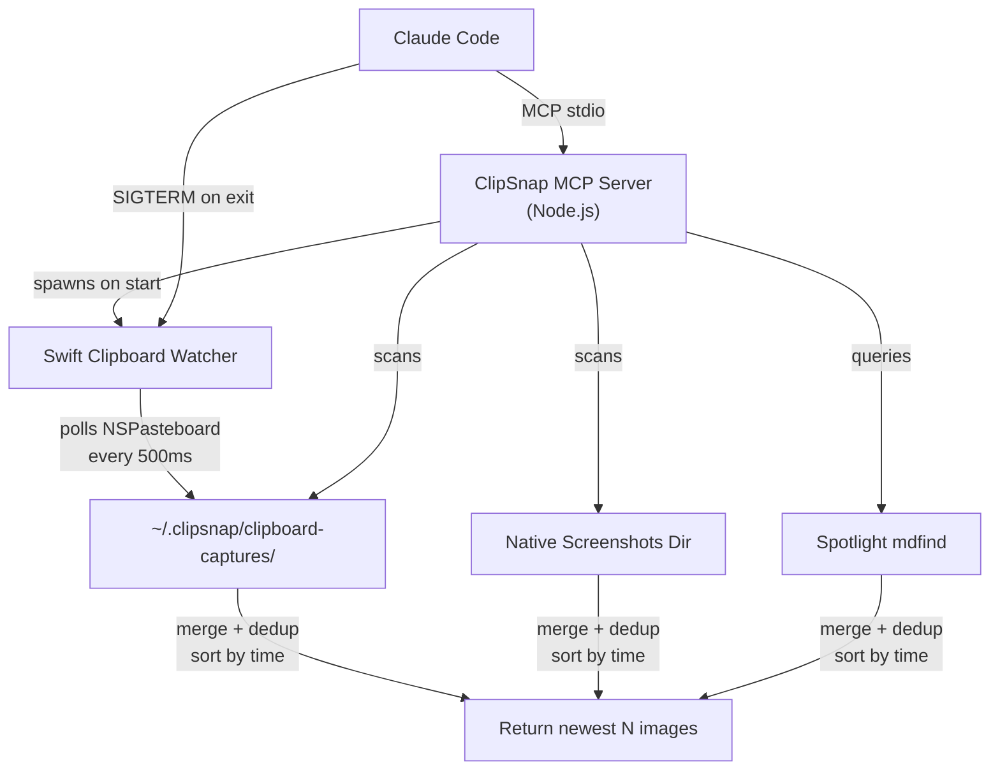

<div align="center">

  

  <h1>ClipSnap</h1>

  <p><strong>Reliable clipboard image paste for Claude Code in iTerm2</strong></p>

  <p>
    <a href="https://opensource.org/licenses/MIT"></a>
    
    
    
    
  </p>

  <p>
    <a href="#quick-start">Quick Start</a>&nbsp;&nbsp;&bull;&nbsp;&nbsp;
    <a href="#how-it-works">How It Works</a>&nbsp;&nbsp;&bull;&nbsp;&nbsp;
    <a href="#tools-reference">Tools</a>&nbsp;&nbsp;&bull;&nbsp;&nbsp;
    <a href="#configuration">Config</a>&nbsp;&nbsp;&bull;&nbsp;&nbsp;
    <a href="#troubleshooting">Troubleshooting</a>
  </p>

</div>

<br>

An [MCP](https://modelcontextprotocol.io/) server that gives Claude Code reliable access to clipboard images and screenshots. A background Swift daemon watches the clipboard in real time, so screenshots from **any** app — including clipboard-only tools like Shottr — are captured automatically and available instantly.

Built to fix the broken `Ctrl+V` image paste in iTerm2 and Terminal.app when using Claude Code. Should also work with any MCP-compatible client (Cursor, Claude Desktop, etc.).

---

## The Problem

> [!WARNING]
> Pasting images into Claude Code via `Ctrl+V` in iTerm2 is unreliable and often fails completely.

These are real, open issues:

| Issue | What happens |
|-------|-------------|
| [claude-code#29776](https://github.com/anthropics/claude-code/issues/29776) | `Ctrl+V` image paste fails silently — "No image found in clipboard" |
| [claude-code#17042](https://github.com/anthropics/claude-code/issues/17042) | `sandbox-exec` blocks clipboard access via `com.apple.hiservices-xpcservice` |
| [claude-code#29365](https://github.com/anthropics/claude-code/issues/29365) | `Ctrl+V` image paste in iTerm2 intermittently fails (still reproducible) |
| [claude-code#1361](https://github.com/anthropics/claude-code/issues/1361) | "Can't paste image from clipboard" (various causes) |

Similar problems exist in other terminal AI tools: [Codex CLI](https://github.com/openai/codex/issues/3397), [Gemini CLI](https://github.com/google-gemini/gemini-cli/issues/15381). The root cause is that terminals have no reliable protocol for transferring binary image data from the macOS clipboard.

---

## The Solution

<table>
<tr>
<td width="50%" valign="top">

### Real-Time Capture
A lightweight Swift daemon polls `NSPasteboard` every 500ms. Clipboard-only screenshots (Shottr Esc, Cmd+C on any image) are captured automatically as PNG files.

</td>
<td width="50%" valign="top">

### Multi-Source Discovery
Parallel search across clipboard watcher dir, native macOS screenshots dir, and Spotlight. Three sources — the newest image wins.

</td>
</tr>
<tr>
<td width="50%" valign="top">

### Sandbox Bypass
MCP servers run **outside** `sandbox-exec`. No more denied clipboard access. No more silent failures.

</td>
<td width="50%" valign="top">

### Smart Processing
Auto-resize to optimal AI vision dimensions (1568px). Saves tokens without losing detail. PNG or JPEG output.

</td>
</tr>
</table>

---

## Quick Start

Clone and build:

```bash
git clone https://github.com/zelentsov-dev/clipsnap-mcp.git
cd clipsnap-mcp
npm install
npm run build    # TypeScript + Swift clipboard watcher
```

Then add to your Claude Code MCP config (`~/.claude.json` or project `.mcp.json`):

```json
{
  "mcpServers": {
    "clipsnap": {
      "command": "node",
      "args": ["/path/to/clipsnap-mcp/dist/index.js"]
    }
  }
}
```

That's it. Now when you say *"look at my screenshot"* or *"check what I just captured"*, Claude Code will use ClipSnap to find your images.

---

## How It Works

```
1. Claude Code starts
   └── MCP server starts
       └── Swift clipboard watcher spawns as background daemon

2. User takes screenshot (any app: native, Shottr, CleanShot X, browser, etc.)
   └── Clipboard gets image
       └── Watcher detects NSPasteboard change within ~500ms
           └── Saves PNG to ~/.clipsnap/clipboard-captures/

3. User: "look at my screenshot"
   └── Claude Code calls paste_recent tool
       └── Parallel search:
           ├── Watcher captures dir    (clipboard images, instant)
           ├── Native screenshots dir  (file-saved screenshots, instant)
           └── Spotlight mdfind        (broad coverage, all apps)
       └── Merge, dedup, sort by time → return newest N as base64 images

4. Claude Code exits
   └── SIGTERM → watcher stops → session files cleaned up
```

<details>
<summary><strong>Architecture Diagram</strong></summary>

<br>



</details>

---

## Tools Reference

### `paste_recent`

Returns the most recent N screenshot images. Combines clipboard watcher captures, native macOS screenshots directory, and Spotlight. Sorted by time, newest first.

| Parameter | Type | Default | Description |
|-----------|------|---------|-------------|
| `count` | `number` (1–10) | `3` | Number of images to return |
| `folder` | `string` | — | Scan a specific folder instead |
| `max_dimension` | `number` | `1568` | Max long edge in pixels |

**Example prompts:** *"Look at my screenshot"*, *"Compare the last 4 screenshots"*, *"Check what I just captured"*

### `cleanup_images`

Deletes temporary ClipSnap session images. Auto-cleanup runs on TTL/size limits, so this is rarely needed.

| Parameter | Type | Default | Description |
|-----------|------|---------|-------------|
| `all` | `boolean` | `false` | Delete ALL sessions, not just current |
| `older_than_minutes` | `number` | — | Delete files older than N minutes |

---

## Configuration

All settings via environment variables:

| Variable | Default | Description |
|----------|---------|-------------|
| `CLIPSNAP_MAX_DIMENSION` | `1568` | Max image long edge (px) |
| `CLIPSNAP_IMAGE_FORMAT` | `png` | Output format (`png` or `jpeg`) |
| `CLIPSNAP_JPEG_QUALITY` | `80` | JPEG quality (1–100) |
| `CLIPSNAP_SCREENSHOTS_DIR` | auto | Native screenshots dir (auto-detected via `defaults read com.apple.screencapture`) |
| `CLIPSNAP_MAX_FILES` | `50` | Max files per session |
| `CLIPSNAP_TTL_MINUTES` | `60` | File time-to-live |
| `CLIPSNAP_MAX_SIZE_MB` | `200` | Max total session size |
| `CLIPSNAP_CHECK_CONCEALED` | `true` | Detect passwords before reading clipboard |
| `CLIPSNAP_CLEANUP_ON_EXIT` | `true` | Delete session files on exit |

### Token Cost

Claude calculates image tokens as `(width x height) / 750`:

| Image Size | Tokens | Cost (Sonnet, $3/1M input) |
|------------|--------|---------------------------|
| 1568x882 (16:9) | ~1,841 | $0.006 |
| 1568x1024 | ~2,141 | $0.006 |
| 800x600 (snippet) | ~640 | $0.002 |

---

## Security

- **Password detection** — checks `ConcealedType` / `TransientType` before reading (1Password, Bitwarden, macOS Keychain)
- **Symlink protection** — `lstat` prevents following symlinks to sensitive files
- **File permissions** — `0600` files, `0700` directories
- **Session isolation** — UUID-based subdirs per process (`$TMPDIR/clipsnap-<uuid>/`)
- **No content logging** — clipboard data is never logged
- **No network calls** — fully offline, zero telemetry

---

## Compatibility

Built and tested with **Claude Code** on **iTerm2** on macOS.

Since ClipSnap is a standard MCP server (stdio transport), it should work with any MCP-compatible client — Cursor, Claude Desktop, Windsurf, etc. — but these haven't been tested yet. If you try it, [let us know](https://github.com/zelentsov-dev/clipsnap-mcp/issues).

**Requirements:**
- macOS 15+ (Sequoia or later)
- Node.js 20+
- Swift 6.2+ (for building the clipboard watcher; optional)

---

## Troubleshooting

<details>
<summary><strong>Watcher not capturing clipboard images</strong></summary>

The Swift watcher binary must be built:

```bash
npm run build   # or: cd watcher && swift build -c release
```

If the binary is missing, ClipSnap still works via Spotlight and native dir scanning — just without real-time clipboard capture.

</details>

<details>
<summary><strong>"No recent images found"</strong></summary>

Take a screenshot or copy an image first:
- `Cmd+Shift+4` (region) or `Cmd+Shift+3` (full screen)
- `Cmd+C` on an image in Preview, Figma, browser
- Shottr, CleanShot X, or any screenshot tool

</details>

<details>
<summary><strong>"Clipboard contains concealed data"</strong></summary>

Your clipboard contains a password (1Password, Bitwarden, etc.). ClipSnap refuses to read it for security. Copy a screenshot instead.

</details>

<details>
<summary><strong>Screenshots directory not found</strong></summary>

ClipSnap auto-detects from `defaults read com.apple.screencapture location`, falling back to `~/Screenshots` or `~/Desktop`. Override with `CLIPSNAP_SCREENSHOTS_DIR`.

</details>

---

## Contributing

Contributions welcome! Please [open an issue](https://github.com/zelentsov-dev/clipsnap-mcp/issues) before starting work on large changes.

---

<div align="center">

<sub>Built by <a href="https://github.com/zelentsov-dev">Aleksei Zelentsov</a></sub>

</div>
