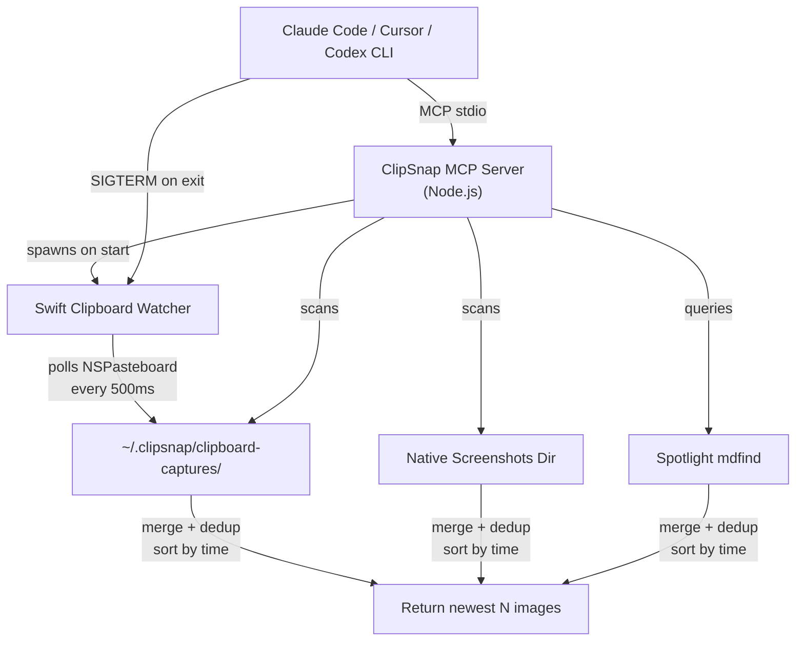

<div align="center">

  

  <h1>ClipSnap</h1>

  <p><strong>Reliable clipboard image paste for terminal AI tools</strong></p>

  <p>
    <a href="https://www.npmjs.com/package/clipsnap-mcp"></a>
    <a href="https://opensource.org/licenses/MIT"></a>
    
    
    
    
  </p>

  <p>
    <a href="#quick-start">Quick Start</a>&nbsp;&nbsp;&bull;&nbsp;&nbsp;
    <a href="#how-it-works">How It Works</a>&nbsp;&nbsp;&bull;&nbsp;&nbsp;
    <a href="#tools-reference">Tools</a>&nbsp;&nbsp;&bull;&nbsp;&nbsp;
    <a href="#configuration">Config</a>&nbsp;&nbsp;&bull;&nbsp;&nbsp;
    <a href="#troubleshooting">Troubleshooting</a>
  </p>

</div>

<br>

An [MCP](https://modelcontextprotocol.io/) server that gives AI coding assistants reliable access to clipboard images and screenshot files. A background Swift daemon watches the clipboard in real time, so screenshots from **any** app — including clipboard-only tools like Shottr — are captured automatically and available instantly.

Works with **Claude Code**, **Codex CLI**, **Gemini CLI**, **Cursor**, **Windsurf**, **Zed**, and any MCP-compatible client.

---

## The Problem

> [!WARNING]
> Pasting images into terminal AI tools fails **40–50% of the time** due to fundamental OS-level bugs.

| Bug | Cause |
|-----|-------|
| **ENOBUFS** ([claude-code#29776](https://github.com/anthropics/claude-code/issues/29776)) | `osascript` dumps the entire PNG as hex, causing buffer overflow |
| **Sandbox** ([claude-code#17042](https://github.com/anthropics/claude-code/issues/17042)) | `sandbox-exec` blocks clipboard access via `com.apple.hiservices-xpcservice` |
| **Race condition** ([claude-code#29365](https://github.com/anthropics/claude-code/issues/29365)) | Async clipboard read not synchronized with terminal focus state |
| **Clipboard not working** ([claude-code#1361](https://github.com/anthropics/claude-code/issues/1361)) | Various "cannot paste image" failures across terminals |

These affect [Claude Code](https://github.com/anthropics/claude-code), [Codex CLI](https://github.com/openai/codex/issues/3397), [Gemini CLI](https://github.com/google-gemini/gemini-cli/issues/15381), and other terminal AI tools. There is no standard protocol for transferring binary image data from the macOS clipboard to a terminal process.

---

## The Solution

<table>
<tr>
<td width="50%" valign="top">

### Real-Time Capture
A lightweight Swift daemon polls `NSPasteboard` every 500ms. Clipboard-only screenshots (Shottr Esc, Cmd+C on any image) are captured automatically as PNG files.

</td>
<td width="50%" valign="top">

### Multi-Source Discovery
Parallel search across clipboard watcher dir, native macOS screenshots dir, and Spotlight. Three sources, zero delay — the newest image wins.

</td>
</tr>
<tr>
<td width="50%" valign="top">

### Sandbox Bypass
MCP servers run **outside** `sandbox-exec`. No more `com.apple.hiservices-xpcservice` denied. No more ENOBUFS. No more race conditions.

</td>
<td width="50%" valign="top">

### Smart Processing
Auto-resize to optimal AI vision dimensions (1568px). Saves tokens without losing detail. PNG or JPEG output. Configurable quality.

</td>
</tr>
<tr>
<td width="50%" valign="top">

### Security First
Detects passwords (`ConcealedType`). UUID session isolation. `0600` file permissions. Zero network calls. Auto-cleanup on exit.

</td>
<td width="50%" valign="top">

### Graceful Degradation
Watcher binary not built? No problem — Spotlight + native dir scanning still works. `pngpaste` missing? Falls back to `osascript`.

</td>
</tr>
</table>

---

## Quick Start

### Claude Code Plugin

```bash
claude plugin add clipsnap-mcp
```

Auto-configures the MCP server, slash commands (`/clipsnap:paste`, `/clipsnap:paste-recent`), and optional hooks.

### Any MCP Client

Add to your configuration (`claude_desktop_config.json`, `.cursor/mcp.json`, etc.):

```json
{
  "mcpServers": {
    "clipsnap": {
      "command": "npx",
      "args": ["-y", "clipsnap-mcp"]
    }
  }
}
```

### Optional: Build the Clipboard Watcher

For real-time clipboard capture (catches Shottr Esc, Cmd+C, etc.):

```bash
cd node_modules/clipsnap-mcp && npm run build
```

Without the watcher, ClipSnap still works using Spotlight and native directory scanning.

---

## How It Works

```
1. Claude Code starts
   └─► MCP server starts
       └─► Swift clipboard watcher spawns as background daemon

2. User takes screenshot (any app: native, Shottr, CleanShot X, browser, etc.)
   └─► Clipboard gets image
       └─► Watcher detects NSPasteboard change within ~500ms
           └─► Saves PNG to ~/.clipsnap/clipboard-captures/clip-<ts>-<uuid>.png

3. User: "look at my screenshot"
   └─► MCP client calls paste_recent tool
       └─► Parallel search:
           ├── Watcher captures dir    (clipboard images, instant)
           ├── Native screenshots dir  (file-saved screenshots, instant)
           └── Spotlight mdfind        (broad coverage, all apps)
       └─► Merge, dedup, sort by time → return newest N as base64 images

4. Claude Code exits
   └─► SIGTERM → watcher stops → session files cleaned up
```

<details>
<summary><strong>Architecture Diagram</strong></summary>

<br>



</details>

---

## Tools Reference

### `paste_recent`

Returns the most recent N screenshot images. Combines clipboard watcher captures, native macOS screenshots directory, and Spotlight. Sorted by time, newest first.

| Parameter | Type | Default | Description |
|-----------|------|---------|-------------|
| `count` | `number` (1–10) | `3` | Number of images to return |
| `folder` | `string` | — | Scan a specific folder instead |
| `max_dimension` | `number` | `1568` | Max long edge in pixels |

**Example prompts:** *"Look at my screenshot"*, *"Compare the last 4 screenshots"*, *"Check what I just captured"*

### `cleanup_images`

Deletes temporary ClipSnap session images. Auto-cleanup runs on TTL/size limits, so this is rarely needed.

| Parameter | Type | Default | Description |
|-----------|------|---------|-------------|
| `all` | `boolean` | `false` | Delete ALL sessions, not just current |
| `older_than_minutes` | `number` | — | Delete files older than N minutes |

---

## Common Issues This Fixes

ClipSnap resolves these known problems with clipboard image paste in terminal AI tools:

| Issue | Affected Tools |
|-------|---------------|
| **ENOBUFS / buffer overflow** when pasting via `osascript` | Claude Code, Codex CLI |
| **`sandbox-exec` blocks clipboard access** (`com.apple.hiservices-xpcservice` denied) | Claude Code |
| **Ctrl+V / Cmd+V image paste fails silently** — "No image found" | All terminal AI tools |
| **Clipboard paste broken in iTerm2** | Claude Code, Codex CLI, Gemini CLI |
| **`pngpaste` not found** — ClipSnap works without it | Claude Code |
| **Clipboard-only screenshots lost** (Shottr Esc, Cmd+C) — never saved to disk | All tools |
| **Spotlight indexing delay** (1–30s) for new screenshots | All tools using `mdfind` |

---

## Configuration

All settings via environment variables in your MCP server config:

| Variable | Default | Description |
|----------|---------|-------------|
| `CLIPSNAP_MAX_DIMENSION` | `1568` | Max image long edge (px) |
| `CLIPSNAP_IMAGE_FORMAT` | `png` | Output format (`png` or `jpeg`) |
| `CLIPSNAP_JPEG_QUALITY` | `80` | JPEG quality (1–100) |
| `CLIPSNAP_SCREENSHOTS_DIR` | auto | Native screenshots dir (auto-detected) |
| `CLIPSNAP_MAX_FILES` | `50` | Max files per session |
| `CLIPSNAP_TTL_MINUTES` | `60` | File time-to-live |
| `CLIPSNAP_MAX_SIZE_MB` | `200` | Max total session size |
| `CLIPSNAP_CHECK_CONCEALED` | `true` | Detect passwords before reading |
| `CLIPSNAP_CLEANUP_ON_EXIT` | `true` | Delete session files on exit |

<details>
<summary><strong>Full config example</strong></summary>

```json
{
  "mcpServers": {
    "clipsnap": {
      "command": "npx",
      "args": ["-y", "clipsnap-mcp"],
      "env": {
        "CLIPSNAP_MAX_DIMENSION": "1568",
        "CLIPSNAP_IMAGE_FORMAT": "png",
        "CLIPSNAP_JPEG_QUALITY": "80",
        "CLIPSNAP_MAX_FILES": "50",
        "CLIPSNAP_TTL_MINUTES": "60",
        "CLIPSNAP_MAX_SIZE_MB": "200",
        "CLIPSNAP_CHECK_CONCEALED": "true",
        "CLIPSNAP_CLEANUP_ON_EXIT": "true"
      }
    }
  }
}
```

</details>

### Token Cost

Claude calculates image tokens as `(width x height) / 750`:

| Image Size | Tokens | Cost (Sonnet, $3/1M input) |
|------------|--------|---------------------------|
| 1568x882 (16:9) | ~1,841 | $0.006 |
| 1568x1024 | ~2,141 | $0.006 |
| 800x600 (snippet) | ~640 | $0.002 |

---

## Building from Source

**Prerequisites:** Node.js 20+, Swift 6.2+ / Xcode 26+ (for watcher), macOS 15+

```bash
git clone https://github.com/zelentsov-dev/clipsnap-mcp.git
cd clipsnap-mcp
npm install
npm run build    # TypeScript (tsc) + Swift watcher (swift build -c release)
```

If Swift is not available, the watcher build is skipped — the server still works via Spotlight and native dir scanning.

```bash
npm run dev      # development mode with tsx
```

---

## Security

- **Password detection** — checks `ConcealedType` / `TransientType` before reading (1Password, Bitwarden, macOS Keychain)
- **Symlink protection** — `lstat` prevents following symlinks to sensitive files
- **File permissions** — `0600` files, `0700` directories
- **Session isolation** — UUID-based subdirs per process (`$TMPDIR/clipsnap-<uuid>/`)
- **No content logging** — clipboard data is never logged
- **No network calls** — fully offline, zero telemetry
- **Graceful cleanup** — SIGTERM stops watcher, deletes session files

---

## Compatibility

### MCP Clients

| Client | Status |
|--------|--------|
| **Claude Code** | Supported — primary target, plugin + standalone |
| **Cursor** | Supported |
| **Claude Desktop** | Supported |
| **Codex CLI** | Supported |
| **Gemini CLI** | Supported |
| **Windsurf** | Supported |
| **Zed** | Supported |

### Terminals

iTerm2, Terminal.app, WezTerm, Kitty, VS Code Terminal, Alacritty — all tested.

### System Requirements

- **macOS** 15+ (Sequoia or later)
- **Node.js** 20+
- **Swift** 6.2+ (optional, for clipboard watcher)
- **sips** (built-in macOS)

---

## Troubleshooting

<details>
<summary><strong>Watcher not capturing clipboard images</strong></summary>

The Swift watcher binary must be built:

```bash
npm run build   # or: cd watcher && swift build -c release
```

If the binary is missing, ClipSnap still works — it just uses Spotlight and native dir scanning instead of real-time clipboard capture. Check stderr for `[clipsnap-watcher]` log lines.

</details>

<details>
<summary><strong>"No recent images found"</strong></summary>

Take a screenshot or copy an image first:
- `Cmd+Shift+4` (region) or `Cmd+Shift+3` (full screen)
- `Cmd+C` on an image in Preview, Figma, browser
- Shottr, CleanShot X, or any screenshot tool

If the watcher is running, clipboard images are captured automatically.

</details>

<details>
<summary><strong>"Clipboard contains concealed data"</strong></summary>

Your clipboard contains a password (1Password, Bitwarden, etc.). ClipSnap refuses to read it for security. Copy a screenshot instead.

To disable: `"CLIPSNAP_CHECK_CONCEALED": "false"` (not recommended).

</details>

<details>
<summary><strong>Screenshots directory not found</strong></summary>

ClipSnap auto-detects from `defaults read com.apple.screencapture location`, falling back to `~/Screenshots` or `~/Desktop`. Override with:

```json
{ "env": { "CLIPSNAP_SCREENSHOTS_DIR": "~/Desktop" } }
```

</details>

<details>
<summary><strong>Images look blurry</strong></summary>

Default output is PNG (lossless). If using JPEG, increase quality:

```json
{ "env": { "CLIPSNAP_JPEG_QUALITY": "95" } }
```

</details>

---

## Contributing

Contributions welcome! Please [open an issue](https://github.com/zelentsov-dev/clipsnap-mcp/issues) before starting work on large changes.

```bash
git clone https://github.com/zelentsov-dev/clipsnap-mcp.git
cd clipsnap-mcp
npm install && npm run build
npm run dev     # development mode
```

---

<div align="center">

<sub>Built by <a href="https://github.com/zelentsov-dev">Aleksei Zelentsov</a></sub>

<p>
  <a href="https://github.com/zelentsov-dev/clipsnap-mcp">GitHub</a>&nbsp;&nbsp;&bull;&nbsp;&nbsp;
  <a href="https://www.npmjs.com/package/clipsnap-mcp">npm</a>&nbsp;&nbsp;&bull;&nbsp;&nbsp;
  <a href="https://github.com/zelentsov-dev/clipsnap-mcp/issues">Issues</a>
</p>

</div>
